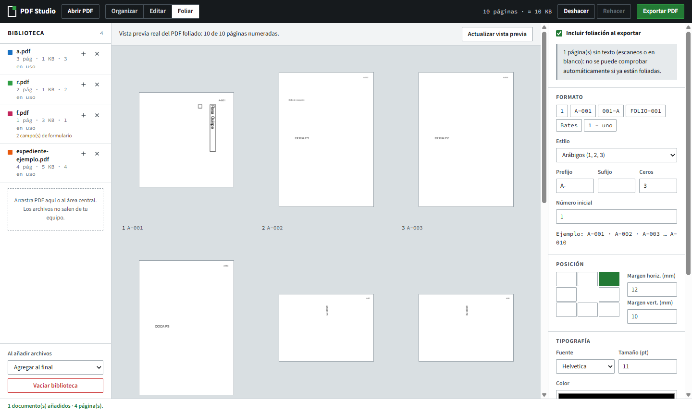

# PDF Studio — organizar, editar y foliar PDF en Chrome

Extensión de Google Chrome (Manifest V3) para **combinar, reordenar, editar y foliar** documentos PDF
desde un panel lateral o un editor de pantalla completa. **Funciona sin conexión**: los documentos
nunca salen de tu equipo y los archivos originales no se modifican.


## Descargas

| Archivo | Descripción |
|---|---|
| [**pdf-studio-0.1.0.zip**](https://github.com/oprbguitar/PDF_num/releases/download/v0.1.0/pdf-studio-0.1.0.zip) | Extensión lista para instalar (incluye el OCR en español sin conexión, unos 6 MB) |
| [Todas las versiones](https://github.com/oprbguitar/PDF_num/releases) | Historial de versiones y notas |

> El repositorio es privado: inicia sesión en GitHub con una cuenta con acceso para descargar.

### Instalación (2 minutos)

1. Descarga `pdf-studio-0.1.0.zip` y **descomprímelo** en una carpeta que no vayas a borrar (por ejemplo `Documentos\PDF Studio`).
2. Abre `chrome://extensions` en Chrome.
3. Activa **Modo de desarrollador** (arriba a la derecha).
4. Pulsa **Cargar descomprimida** y elige la carpeta descomprimida (la que contiene `manifest.json`).
5. Fija el icono de PDF Studio en la barra. Al pulsarlo se abre el **panel lateral**.

Para actualizar: descomprime la nueva versión en la misma carpeta y pulsa ⟳ en `chrome://extensions`.

## Qué puedes hacer

### 1. Organizar y combinar
- Abre o arrastra varios PDF a la vez. Cada documento tiene un color para reconocer de dónde viene cada página.
- Reordena páginas arrastrándolas, también entre documentos distintos. Soltar un PDF sobre la rejilla lo inserta en esa posición.
- Rota (±90°), duplica, elimina, mueve al inicio o al final e inserta páginas en blanco del mismo tamaño que la anterior.
- **Extrae** la selección como PDF nuevo o **separa** el documento por rangos (`1-3, 4-10, 11`).
- Ves el total de páginas y el tamaño estimado. Los formularios se conservan al combinar.
- Atajos: `Ctrl+A`, `Supr`, `R` / `Mayús+R`, `Ctrl+D`, `Alt+←/→`, `Ctrl+Z` / `Ctrl+Y`, `Ctrl+S`.

### 2. Editar


- **Texto**, **resaltado**, **tapado**, **imagen** (sello, firma escaneada) y **firma a mano alzada**. Los objetos se mueven y redimensionan, y se editan su fuente, tamaño y color.
- Detecta si la página es **digital** (con texto) o **escaneada** (imagen sin texto). En las escaneadas se añade contenido encima sin tocar la imagen original.
- **Formularios**: rellena los campos AcroForm y, si quieres, aplánalos al exportar.
- **OCR opcional** en español, 100 % local: busca dentro del texto reconocido y, si lo eliges, incrústalo como capa invisible para buscar y copiar en el PDF exportado.
- **Comparar con el original**: muestra lado a lado la página original y el PDF tal como se exportará.
- Deshacer y rehacer ilimitado dentro de la sesión. La sesión se recupera sola si cierras la pestaña.

### 3. Foliar


- Formatos: arábigos, romanos (I / i), alfabéticos (A / a), mixtos (`A-001`, `001-A`, `FOLIO-001`), **Bates** y **número y letras** (`1 - uno`).
- Posición en 8 puntos (esquinas, centros y laterales), márgenes en milímetros, fuente, tamaño y color, número inicial, prefijo, sufijo y relleno con ceros.
- Excluye páginas (p. ej. la carátula), elige si las excluidas consumen número, numeración **continua entre documentos** o reiniciada por documento, y **reinicios por sección** (`12, 30:100`).
- **Vista previa real** de todas las páginas: es el PDF foliado de verdad, no una simulación.
- Avisa si el documento **ya parece estar foliado**.
- El folio forma parte del contenido visible de la página, no es una etiqueta interna del visor.

## Privacidad y seguridad
- Sin servidores ni telemetría. Permisos de Chrome: solo `sidePanel`.
- Trabaja sobre copias en memoria. La biblioteca temporal vive en el almacenamiento local de la extensión y se borra con **Vaciar biblioteca**.
- Avisos al cargar un documento: **cifrado** (solo lectura), **firma digital** (se invalidará), formularios, XFA, marcadores y JavaScript que no se trasladan.
- **Tapar no es censurar**: el rectángulo opaco oculta visualmente, pero el contenido sigue dentro del PDF.

## Limitaciones
- No reescribe el texto existente de un PDF digital: lo añadido se dibuja encima. Ninguna biblioteca del navegador lo hace con fidelidad comprobable.
- No modifica PDF cifrados.
- Al combinar se pierden los marcadores, el JavaScript de documento y los formularios XFA.
- Folio y texto usan las fuentes estándar (Helvetica, Times, Courier). Los caracteres fuera de Latin-1 se sustituyen por «?».
- La calidad del OCR depende del escaneo, y su capa de texto se ubica de forma aproximada.

Detalle completo, matriz de reutilización y qué está verificado: [docs/DECISIONES.md](docs/DECISIONES.md).

## Desarrollo

Requisitos: Node 22 o superior.

```bash
npm install
npm test               # 32 pruebas del núcleo con PDF reales y sintéticos
npm run build          # genera dist/extension
npm run package        # genera además dist/pdf-studio-<versión>.zip
```

Prueba de extremo a extremo con la extensión real cargada (Chromium o Chrome for Testing; Chrome estable ≥ 137 ya no admite `--load-extension`):

```bash
CHROMIUM="/ruta/a/chrome" npm run test:e2e
```

Para probar la interfaz sin instalar la extensión: `npm run build` y `node scripts/serve.mjs`, luego abre `http://localhost:5178/editor.html`. Las funciones `chrome.*` (abrir pestañas desde el panel) no estarán disponibles.

### Estructura

```
extension/   manifest, HTML y estilos (tokens en styles/tokens.css)
src/core/    núcleo sin interfaz: organize, folio, edit, inspect, pipeline (probado en Node)
src/ui/      editor, panel lateral, worker de exportación, pdf.js, OCR, IndexedDB
scripts/     build (esbuild + iconos + zip) y servidor local
test/        pruebas unitarias/integración (node:test) y E2E (CDP)
docs/        decisiones técnicas y capturas
```

Cada operación pesada corre en un **Web Worker**, así que no bloquea la interfaz y **Cancelar** detiene el trabajo de verdad. Cada exportación **reabre el PDF generado** y comprueba el número de páginas antes de entregarlo.

### Tecnologías
pdf-lib (MIT) · pdf.js (Apache-2.0) · tesseract.js + datos `spa` (Apache-2.0) · esbuild · Source Sans 3 y Source Code Pro (OFL).
Lógica de etiquetas y Bates adaptada de [PDFcraft](https://github.com/storytold/pdfcraft) (MIT OR Apache-2.0). Ver [THIRD_PARTY_NOTICES.md](THIRD_PARTY_NOTICES.md).

## Licencia
MIT. Ver [LICENSE](LICENSE).
