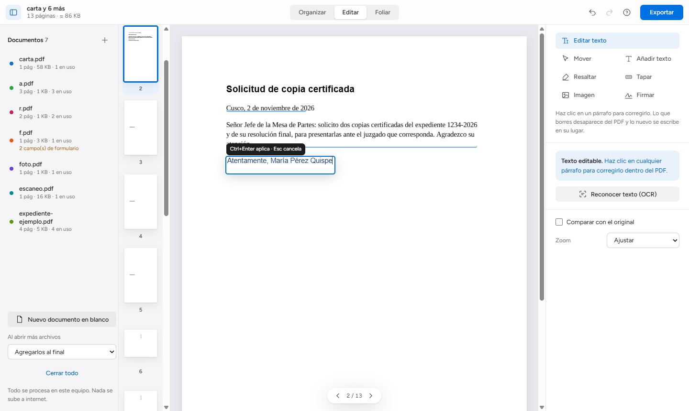
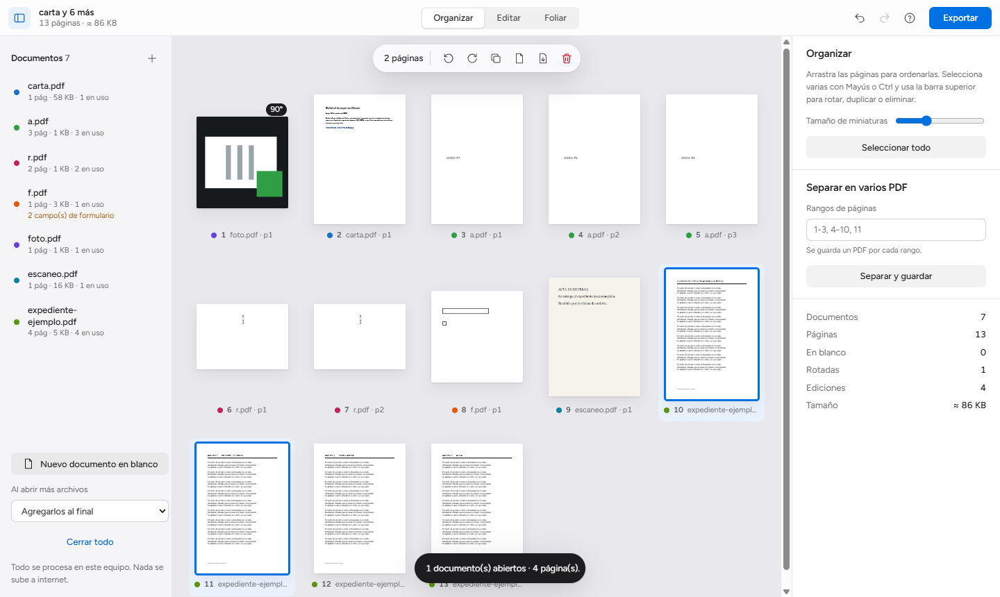

# PDF Studio

**Versión actual: 0.2.0** (30 de octubre de 2026) · [Novedades](CHANGELOG.md) · [Guía de uso](https://oprbguitar.github.io/PDF_num/) · [Guía en PDF](https://oprbguitar.github.io/PDF_num/guia-pdf-studio.pdf)

Extensión de Google Chrome para **organizar, corregir y foliar PDF**, sencilla y privada.
Corrige el texto **dentro del propio PDF**, combina documentos, convierte fotos en páginas y numera
expedientes. Funciona sin conexión: tus documentos nunca salen de tu equipo.



## Descargas

| Archivo | Para qué |
|---|---|
| [**pdf-studio-0.2.0.zip**](https://github.com/oprbguitar/PDF_num/releases/download/v0.2.0/pdf-studio-0.2.0.zip) | Extensión lista para instalar (incluye OCR en español sin conexión) |
| [pdf-studio.zip (siempre la última)](https://github.com/oprbguitar/PDF_num/releases/latest/download/pdf-studio.zip) | El mismo paquete con un nombre fijo, para enlazarlo |
| [Guía de uso en PDF](https://oprbguitar.github.io/PDF_num/guia-pdf-studio.pdf) | Manual para imprimir o compartir |
| [Todas las versiones](https://github.com/oprbguitar/PDF_num/releases) | Historial y notas de cada versión |

### Instalar en 2 minutos
1. Descarga el `.zip` y **descomprímelo** en una carpeta que no vayas a borrar.
2. Abre `chrome://extensions` en Chrome y activa **Modo de desarrollador**.
3. Pulsa **Cargar descomprimida** y elige la carpeta que contiene `manifest.json`.
4. Fija el icono de PDF Studio. Al pulsarlo se abre el panel lateral. `Alt+Mayús+P` abre el editor completo.

Para actualizar, descomprime la nueva versión en la misma carpeta y pulsa ⟳ en `chrome://extensions`.

## Qué hace

**Editar**
- **Corregir el texto existente**: clic en un párrafo, borra y escribe. El texto original se elimina del PDF y el nuevo ocupa su lugar, con la misma posición, tamaño y color. Usa la fuente del documento si contiene las letras; si no, una de medidas idénticas (Arial→Arimo, Times→Tinos, Courier→Cousine, Calibri→Carlito).
- **Escaneos**: OCR en español sin conexión. Después se corrige cada línea con un clic: se tapa con el color del papel y se escribe con el color de la tinta.
- Añadir texto, resaltar, tapar, imágenes o sellos, firma a mano, formularios. Comparar con el original. Deshacer y rehacer.

**Organizar y crear**
- Combinar varios PDF; arrastrar páginas entre documentos; rotar, duplicar, eliminar, páginas en blanco; extraer y separar por rangos.
- Crear un PDF desde cero o desde fotos (JPG, PNG, WebP).

**Foliar**
- Formatos 1 / I / i / A / a, `A-001`, `001-A`, `FOLIO-001`, Bates y `1 - uno`. 8 posiciones, márgenes en mm, exclusiones, reinicios por sección, numeración continua o por documento.
- Vista previa del PDF ya foliado y aviso si el documento parece estar foliado.

**Ayuda integrada**: `F1` abre el manual con buscador, en el tema del modo en que estás. La primera vez aparece un recorrido de 5 pasos que puedes saltar o repetir.



## Privacidad
Sin servidores ni analítica. Permisos: solo `sidePanel`. Los originales nunca se modifican: siempre se descarga una copia verificada.

## Limitaciones
- La corrección de texto trabaja por párrafo: el formato mixto dentro de un mismo párrafo se unifica.
- No se pueden corregir textos cuya fuente no declara sus caracteres (sin ToUnicode) ni los que están dentro de objetos reutilizables (XObject de formulario), y tampoco el texto vertical.
- En escaneos, la imagen original sigue debajo del recuadro de corrección.
- «Tapar» no es una censura segura. Para borrar texto de verdad usa «Editar texto».
- No se modifican PDF cifrados, y las firmas digitales se invalidan al modificar.

Detalle técnico y matriz de reutilización: [docs/DECISIONES.md](docs/DECISIONES.md).

## Desarrollo
Requisitos: Node 22 o superior.

```bash
npm install
npm test               # 41 pruebas del núcleo
npm run build          # dist/extension
npm run package        # además dist/pdf-studio-<versión>.zip
npm run site           # guía pública en docs/ (GitHub Pages)
```

Prueba de extremo a extremo con la extensión real (Chromium o Chrome for Testing; Chrome estable ≥ 137 ya no admite `--load-extension`):

```bash
CHROMIUM="/ruta/a/chrome" npm run test:e2e
```

Estructura: `extension/` (manifest, HTML, estilos con tokens) · `src/core/` (núcleo sin interfaz: `content.js` lector de flujos, `textedit.js` edición de texto, `organize`, `edit`, `folio`, `pipeline`) · `src/ui/` (editor, panel lateral, worker, ayuda) · `scripts/` (build, sitio, servidor) · `test/` · `docs/` (sitio de GitHub Pages).

Tecnologías: pdf-lib, @pdf-lib/fontkit, pdf.js, tesseract.js, esbuild y las fuentes Figtree, Arimo, Tinos, Cousine y Carlito (OFL). El enfoque de edición de texto sigue a [PDFcraft](https://github.com/storytold/pdfcraft). Ver [THIRD_PARTY_NOTICES.md](THIRD_PARTY_NOTICES.md).

## Licencia
MIT.
